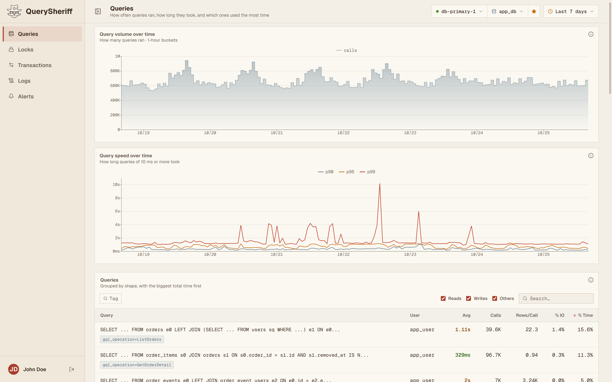
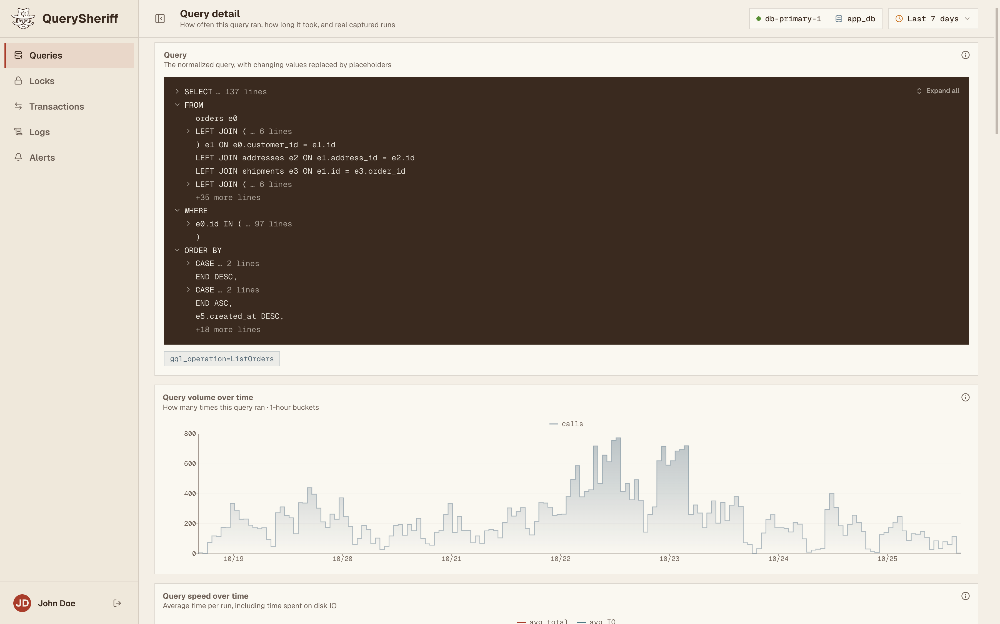
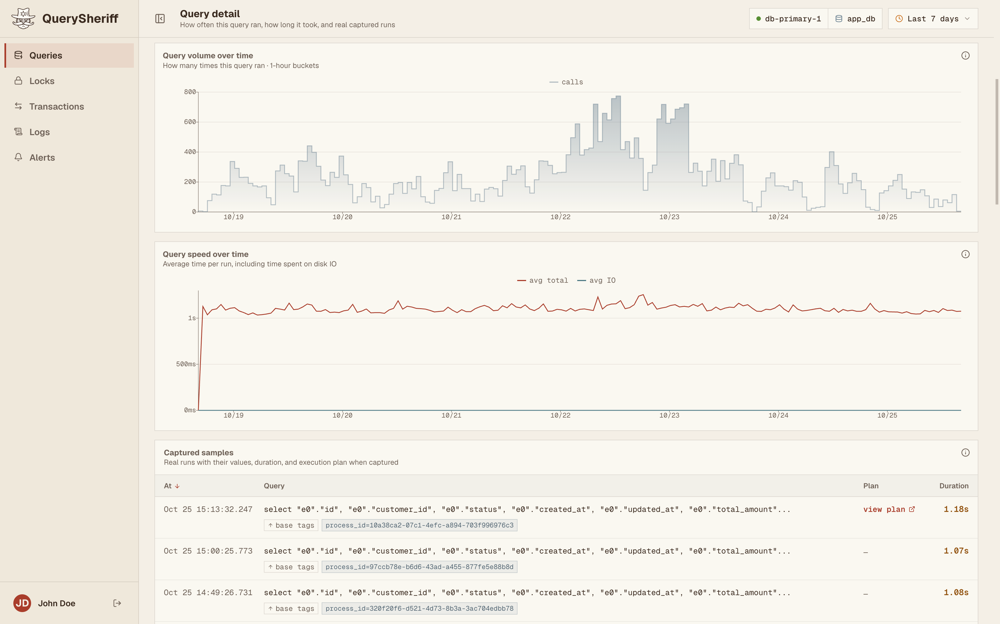
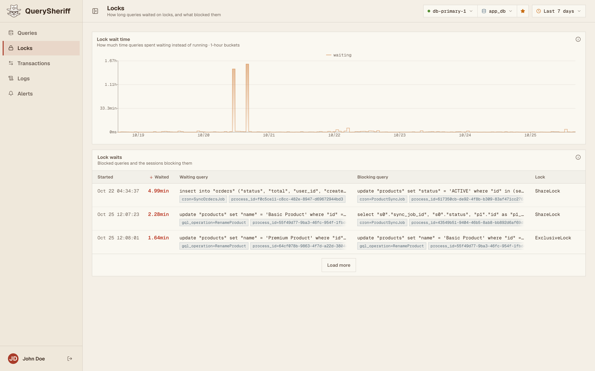
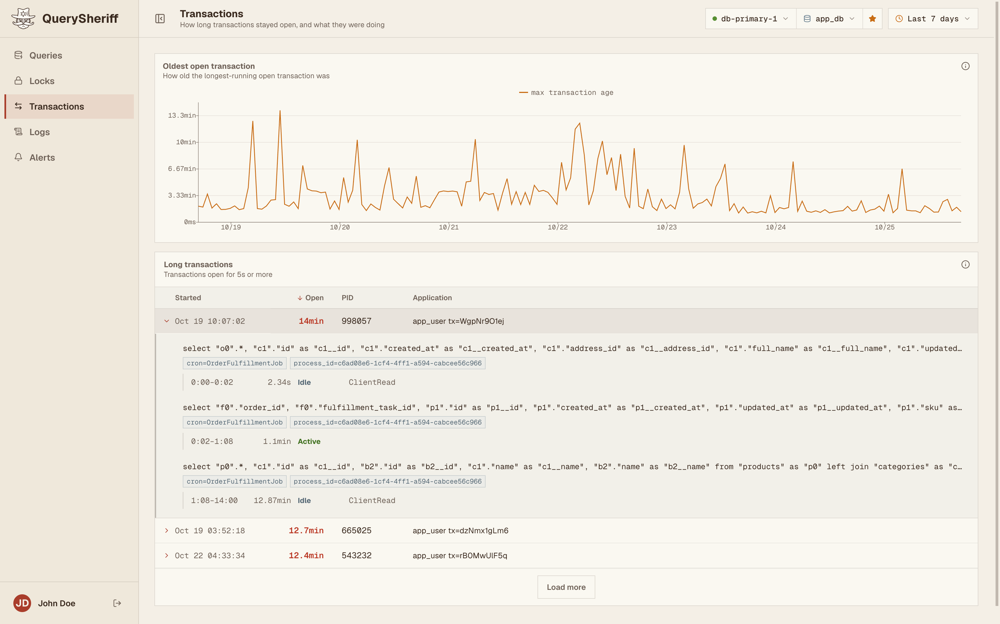
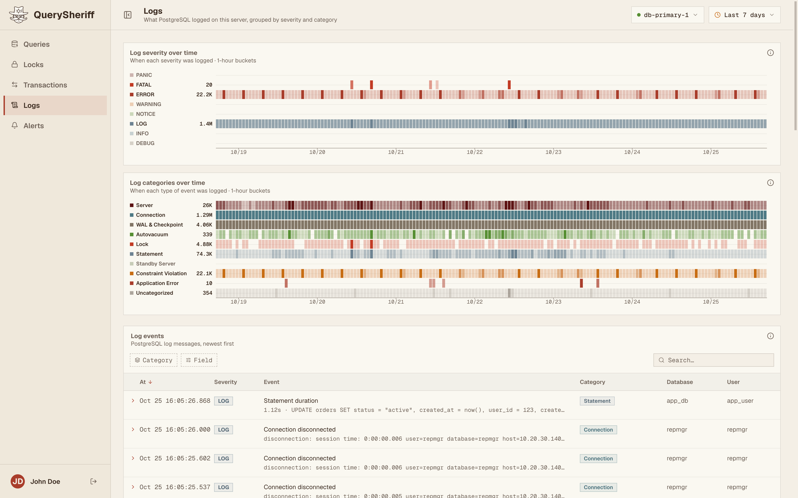
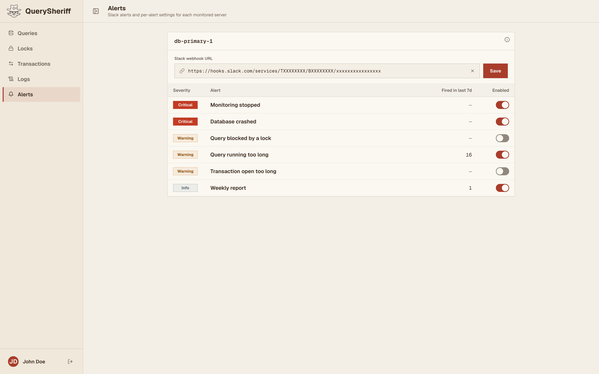

  

<h1 align="center">QuerySheriff</h1>

QuerySheriff is a PostgreSQL performance monitoring tool. It monitors queries, lock waits, long transactions and server logs, and uses query tags in SQL comments to trace each query back to the code that sent it.

With it you can:

- See which queries take the most time, with their captured runs and execution plans
- Find out which session blocked which, and for how long
- Follow a long transaction on a timeline of every query it ran
- Search PostgreSQL logs by severity and category
- Get Slack alerts on crashes, lock waits, slow queries and long transactions, plus a weekly report

## Screenshots

<table>
  <tr>
    <td></td>
    <td></td>
  </tr>
  <tr>
    <td align="center">Query detail</td>
    <td align="center">Captured runs</td>
  </tr>
  <tr>
    <td></td>
    <td></td>
  </tr>
  <tr>
    <td align="center">Locks</td>
    <td align="center">Transactions</td>
  </tr>
  <tr>
    <td></td>
    <td></td>
  </tr>
  <tr>
    <td align="center">Logs</td>
    <td align="center">Alerts</td>
  </tr>
</table>

## Repositories

| Repository | Contents |
| --- | --- |
| [collector](https://github.com/querysheriff/collector) | Go agent on each PostgreSQL server |
| [backend](https://github.com/querysheriff/backend) | Go service that stores the data and sends alerts |
| [frontend](https://github.com/querysheriff/frontend) | SvelteKit dashboard |
| [docs](https://github.com/querysheriff/docs) | Deployment guide and Helm chart |
| [sqltags](https://github.com/querysheriff/sqltags) | Go and TypeScript libraries for query tags |
| [system-tests](https://github.com/querysheriff/system-tests) | End-to-end browser tests |

To run it, follow the [deployment guide](https://github.com/querysheriff/docs/blob/master/deployment.md).
